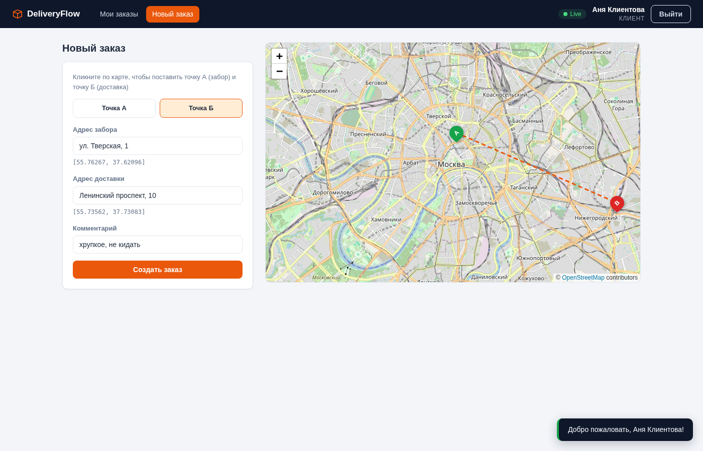
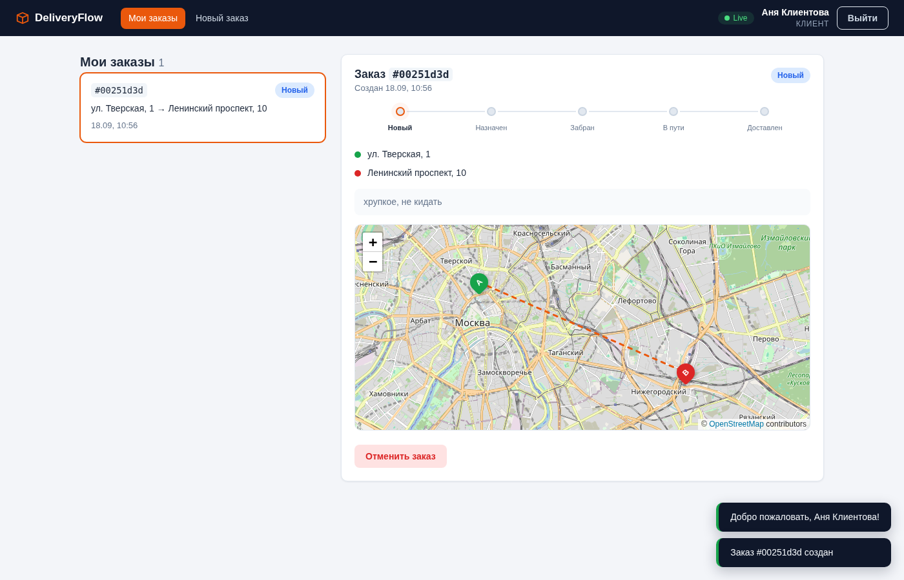
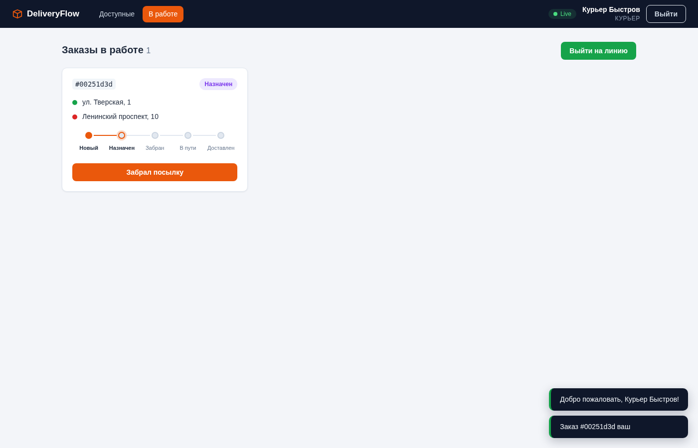
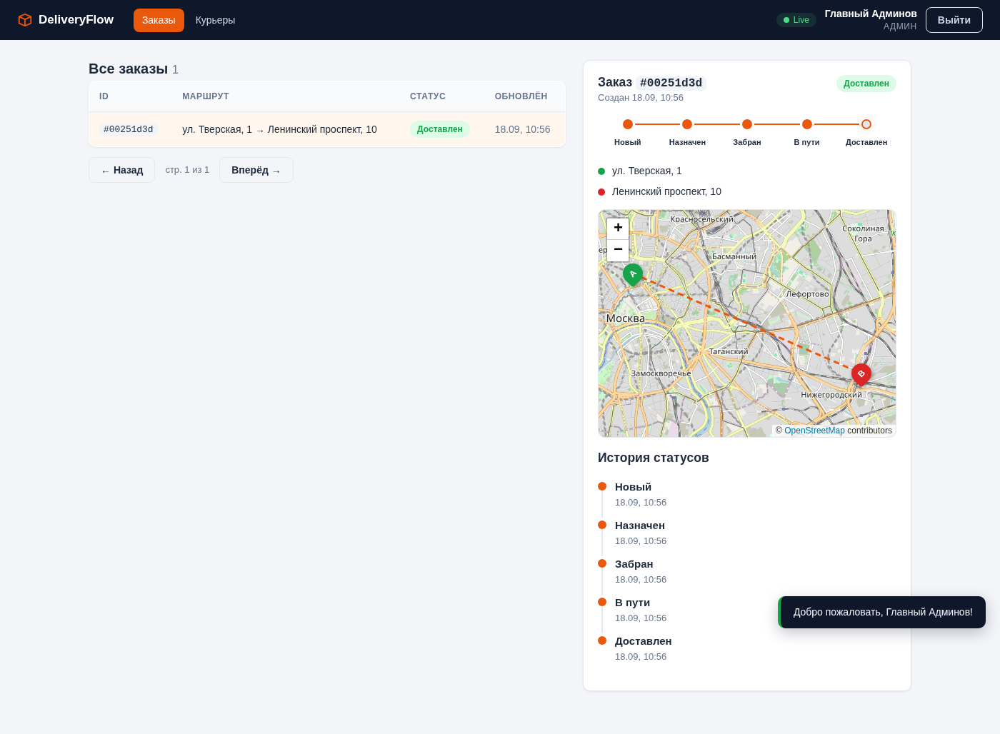

# DeliveryFlow

[Русская версия](README.ru.md)

[](https://github.com/Imronaxl/DeliveryHigh/actions/workflows/ci.yml)

A delivery system with three roles: a client creates an order, a courier accepts and delivers it, an admin reviews orders and their history. The repository is called DeliveryHigh, the application DeliveryFlow.

Java 21 · Spring Boot 3.3 · PostgreSQL 16 · Kafka · Redis · WebSocket/STOMP · Vanilla JS · Leaflet

## Run

Requires Docker with Compose v2.

```bash
cp .env.example .env
```

Set `JWT_SECRET` to at least 32 bytes; the backend refuses to start without it. To create an admin, set `ADMIN_EMAIL` and `ADMIN_PASSWORD` (12–72 characters). The admin is created on first start and an existing password is never overwritten. Public registration is open to clients and couriers only.

```bash
docker compose up --build -d
docker compose logs -f backend
```

Open http://localhost:8088. The first start takes a while: images and dependencies are downloaded, then migrations run.

| Service | Address |
|---|---|
| Web client | http://localhost:8088 |
| API | http://localhost:8080/api/v1 |
| Health | http://localhost:8080/actuator/health |
| Kafka UI | http://localhost:8090 |
| Prometheus | http://localhost:9090 |
| Grafana | http://localhost:3000 |

All ports are bound to `127.0.0.1`. Grafana uses the demo login `admin`/`admin` and the database uses `delivery`/`delivery`; change both and add TLS before exposing anything on a server. The JWT and user data are kept in `sessionStorage`, separately for each browser tab. Logging out removes the tab's session; refresh tokens are not revoked on the server.

## Demo scenario

1. Register a client and a courier in different tabs. In a third tab sign in as the admin created through the environment variables.
2. Client: "New order", enter both addresses, mark two points on the map, "Create order".
3. Courier: "Available" → "Take order" → "Go online".
4. Client: open the order. The map receives the courier's coordinates over WebSocket.
5. Courier: "Picked up" → "On the way" → "Delivered".
6. Admin: pick an order to see its map and history.

The courier's position is simulated in the browser every three seconds. The A–B line on the map is straight; geocoding, road routing, ETA and real GPS are not implemented.

## Architecture

The backend is a layered monolith. REST commands go through Spring Security, services and JPA into PostgreSQL. Status changes run under a row lock on the order until commit. The history row and the outbox event are saved in the same transaction.

A scheduler reads the outbox and sends events to Kafka; a row is deleted only after the broker acknowledges it. If the broker is unavailable, the transaction rolls back and sending is retried in the same order. Delivery is at least once, so duplicates are possible after a failure. A row that can never be sent (unknown type or broken payload) is marked `failed_at` and skipped, so it cannot block the events behind it. Consumers pass events to the STOMP broker, and courier coordinates are also written to Redis GEO.

The simple broker lives in the memory of a single backend instance, so the current configuration supports one instance. Running several needs an external STOMP broker or a separate fan-out scheme.

The WebSocket endpoint is `/ws`. The JWT is sent in the STOMP `CONNECT` frame; `SUBSCRIBE` checks the user's role and relation to the order or courier. Client `SEND` frames are rejected. After a disconnect the frontend reconnects and restores its subscriptions.

```
src/main/java/com/deliveryflow/
├── api/             HTTP controllers, DTOs, errors
├── config/          Security, Kafka, Redis, STOMP, admin bootstrap
├── domain/          JPA entities, enums, repositories
├── infrastructure/  Redis GEO, WebSocket broadcast
├── mapper/          MapStruct
├── messaging/       events, outbox, producers, consumers
├── security/        JWT and the current user
└── service/         application use cases
src/main/resources/db/migration/
src/test/java/
frontend/
├── css/
├── js/              ES modules, router, API, auth, maps, views
├── lib/             local Leaflet and STOMP
└── tests/           Node.js tests
```

## Order statuses

`CREATED → ASSIGNED → PICKED_UP → IN_TRANSIT → DELIVERED`

The creator can cancel an order from `CREATED` or `ASSIGNED` (`CANCELLED`). Terminal states never change. The assigned courier can only perform the next delivery step. A client reads their own orders; an admin reads any.

## API

All paths start with `/api/v1`. Protected requests use `Authorization: Bearer <accessToken>`.

| Method | Path | Purpose |
|---|---|---|
| POST | `/auth/register` | email, password, name, phone, role: CLIENT/COURIER |
| POST | `/auth/login` | sign in with email/password |
| POST | `/auth/refresh` | new token pair from a refresh token |
| POST | `/orders` | create an order |
| GET | `/orders/me` | the client's orders |
| GET | `/orders/{id}` | order card with an access check |
| DELETE | `/orders/{id}` | cancel an order |
| GET | `/courier/orders/available` | orders in `CREATED` |
| GET | `/courier/orders/active` | the current courier's active orders |
| PATCH | `/courier/orders/{id}/accept` | accept an order |
| PATCH | `/courier/orders/{id}/status` | body `{ "status": "PICKED_UP" }` |
| POST | `/courier/location` | latitude, longitude |
| GET | `/admin/orders?page=0&size=10&sort=createdAt,desc` | a page of orders |
| GET | `/admin/couriers` | couriers |
| GET | `/admin/orders/{id}/history` | history, newest first |

Creating an order takes `pickupAddress`, `pickupLat`, `pickupLng`, `deliveryAddress`, `deliveryLat`, `deliveryLng` and an optional `description`. Latitude is limited to ±90°, longitude to ±180°.

| STOMP topic | Payload |
|---|---|
| `/topic/admin/orders` | order events, ADMIN only |
| `/topic/orders/available` | `OrderCreatedEvent` or a change in availability |
| `/topic/orders/{id}/status` | `OrderStatusChangedEvent` |
| `/topic/courier/{id}/location` | `CourierLocationUpdatedEvent` |

Kafka topics: `orders.created`, `orders.status-changed`, `courier.location-updated`, `notifications.send`. The last consumer only writes the notification to the log; no external delivery channel is connected.

## Development

Requires JDK 21 and Docker; Node.js 20+ for the frontend tests.

```bash
docker compose up -d postgres redis kafka zookeeper
JWT_SECRET=<at least 32 bytes> ./gradlew bootRun
```

Pass `ADMIN_EMAIL` and `ADMIN_PASSWORD` the same way to bootstrap an admin. Locally the app uses database `deliveryflow` with user and password `delivery/delivery`, Redis on 6379 and Kafka on 9092.

```bash
cd frontend
python3 -m http.server 8000
```

Open http://localhost:8000. For the development ports 5500, 8000, 8081 and 3001 the API is routed to localhost:8080.

```bash
./gradlew test
./gradlew spotlessCheck bootJar
node --test frontend/tests/*.test.js
node scripts/smoke.mjs
```

`scripts/smoke.mjs` needs a running Compose stack and Node.js 22+. It checks Kafka → STOMP, coordinates through Redis, concurrent assignment and the full delivery cycle. Pass `ADMIN_EMAIL` and `ADMIN_PASSWORD` to check the history too.

Unit tests cover statuses, access and JWT handling, and the outbox (acknowledged delete, retry on broker failure, skipping an unsendable event). HTTP tests start Spring Boot on H2 with external infrastructure disabled. The PostgreSQL migration and HTTP scenario test uses Testcontainers and is skipped without Docker. H2 tests do not replace checking the PostgreSQL migrations and the full Compose stack, which CI does in its `smoke` job.

Flyway applies migrations and Hibernate checks the schema with `ddl-auto: validate`. Add a new migration to change an existing database.

## Screenshots





