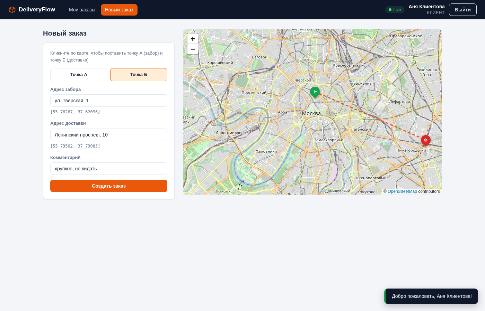
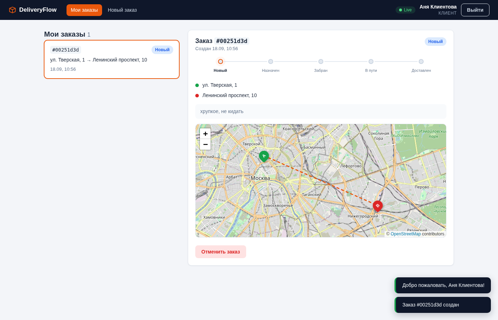
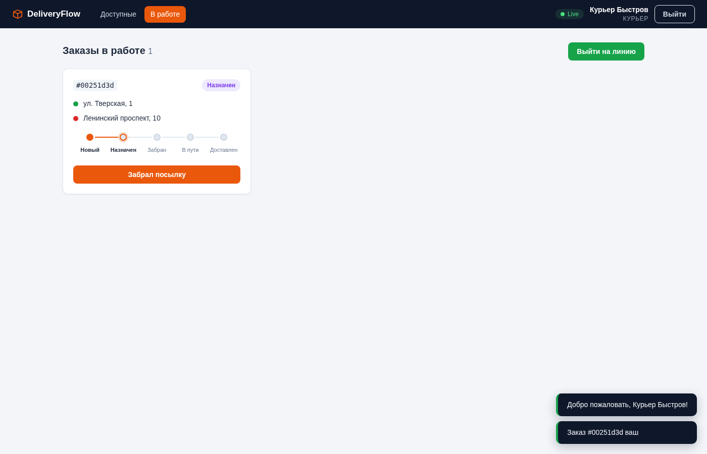
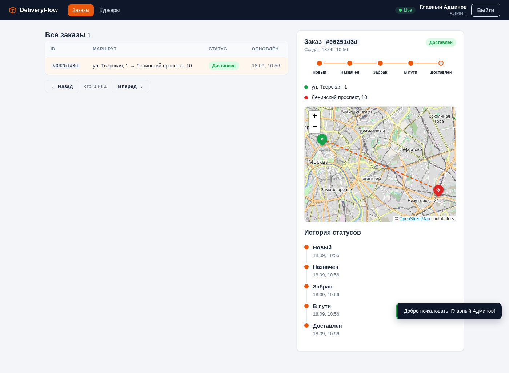

# DeliveryFlow

Система доставки с тремя ролями: клиент создаёт заказ, курьер принимает и доставляет его, администратор просматривает заказы и историю. Репозиторий называется DeliveryHigh, приложение — DeliveryFlow.

Java 21 · Spring Boot 3.3 · PostgreSQL 16 · Kafka · Redis · WebSocket/STOMP · Vanilla JS · Leaflet

## Запуск

Нужен Docker с Compose v2.

```bash
cp .env.example .env
```

В `.env` задайте `JWT_SECRET` длиной не менее 32 байт. Для создания администратора укажите `ADMIN_EMAIL` и `ADMIN_PASSWORD` длиной 12–72 символа. Администратор создаётся при первом запуске; существующий пароль автоматически не меняется. Публичная регистрация доступна только клиентам и курьерам.

```bash
docker compose up --build -d
docker compose logs -f backend
```

Откройте http://localhost:8088. Первый запуск занимает время: загружаются образы и зависимости, затем применяются миграции.

| Сервис | Адрес |
|---|---|
| Веб-клиент | http://localhost:8088 |
| API | http://localhost:8080/api/v1 |
| Health | http://localhost:8080/actuator/health |
| Kafka UI | http://localhost:8090 |
| Prometheus | http://localhost:9090 |
| Grafana | http://localhost:3000 |

Grafana использует демонстрационные `admin/admin`. Сервисы инфраструктуры открывают локальные порты; перед размещением на сервере ограничьте доступ и настройте TLS. JWT и сведения о пользователе хранятся в sessionStorage отдельно для каждой вкладки. Выход удаляет сессию вкладки; серверного отзыва refresh-токенов нет.

## Сценарий

1. Зарегистрируйте клиента и курьера в разных вкладках. В третьей войдите администратором, созданным через переменные окружения.
2. Клиент: «Новый заказ», адреса и две точки на карте, затем «Создать заказ».
3. Курьер: «Доступные» → «Взять заказ» → «Выйти на линию».
4. Клиент: откройте заказ. Карта получает координаты через WebSocket.
5. Курьер: «Забрал посылку» → «Выехал к клиенту» → «Доставлен».
6. Администратор: выберите заказ для просмотра карты и истории.

Координаты курьера симулируются в браузере раз в три секунды. Линия A–B на карте прямая; геокодирование, дорожные маршруты, ETA и настоящий GPS не реализованы.

## Архитектура

Backend — слоистый монолит. REST-команды проходят через Spring Security, сервисы и JPA в PostgreSQL. Статусы меняются под блокировкой строки заказа до commit. История и событие outbox сохраняются в той же транзакции.

Планировщик читает outbox и отправляет события в Kafka. После подтверждения брокером запись удаляется. При ошибке транзакция откатывается и отправка повторяется. Доставка — at least once: после сбоя возможны дубликаты. Consumers передают события в STOMP broker; координаты также записываются в Redis GEO.

Simple broker находится в памяти одного backend. Текущая конфигурация рассчитана на один экземпляр приложения. Для нескольких экземпляров нужен внешний STOMP broker или отдельная схема рассылки событий.

WebSocket подключается по `/ws`. JWT передаётся в STOMP CONNECT; SUBSCRIBE проверяет роль и отношение пользователя к заказу/курьеру. Клиентские SEND запрещены. После разрыва frontend повторяет подключение и восстанавливает подписки.

```text
src/main/java/com/deliveryflow/
├── api/             HTTP-контроллеры, DTO, ошибки
├── config/          Security, Kafka, Redis, STOMP, bootstrap администратора
├── domain/          JPA-сущности, enum, репозитории
├── infrastructure/  Redis GEO, WebSocket-рассылка
├── mapper/          MapStruct
├── messaging/       События, outbox, producers, consumers
├── security/        JWT и текущий пользователь
└── service/         Сценарии приложения
src/main/resources/db/migration/
src/test/java/
frontend/
├── css/
├── js/              ES modules, роутер, API, авторизация, карты, экраны
├── lib/             Локальные Leaflet и STOMP
└── tests/           Node.js tests
```

## Статусы

`CREATED → ASSIGNED → PICKED_UP → IN_TRANSIT → DELIVERED`

Из `CREATED` и `ASSIGNED` создатель может отменить заказ: `CANCELLED`. Терминальные состояния не изменяются. Назначенный курьер может выполнить только следующий этап доставки. Клиент читает свои заказы, администратор — любые.

## API

Все пути ниже начинаются с `/api/v1`. Защищённые запросы используют `Authorization: Bearer <accessToken>`.

| Метод | Путь | Назначение |
|---|---|---|
| POST | `/auth/register` | email, password, name, phone, role: CLIENT/COURIER |
| POST | `/auth/login` | Вход по email/password |
| POST | `/auth/refresh` | Новая пара JWT по refreshToken |
| POST | `/orders` | Создать заказ |
| GET | `/orders/me` | Заказы клиента |
| GET | `/orders/{id}` | Карточка с проверкой доступа |
| DELETE | `/orders/{id}` | Отменить заказ |
| GET | `/courier/orders/available` | Заказы CREATED |
| GET | `/courier/orders/active` | Активные заказы текущего курьера |
| PATCH | `/courier/orders/{id}/accept` | Принять заказ |
| PATCH | `/courier/orders/{id}/status` | Тело `{ "status": "PICKED_UP" }` |
| POST | `/courier/location` | latitude, longitude |
| GET | `/admin/orders?page=0&size=10&sort=createdAt,desc` | Страница заказов |
| GET | `/admin/couriers` | Курьеры |
| GET | `/admin/orders/{id}/history` | История, сначала новые записи |

Создание заказа принимает `pickupAddress`, `pickupLat`, `pickupLng`, `deliveryAddress`, `deliveryLat`, `deliveryLng`, необязательный `description`. Широта ограничена ±90°, долгота ±180°.

| STOMP topic | Payload |
|---|---|
| `/topic/admin/orders` | События заказов для ADMIN |
| `/topic/orders/available` | OrderCreatedEvent или изменение доступности заказа |
| `/topic/orders/{id}/status` | OrderStatusChangedEvent |
| `/topic/courier/{id}/location` | CourierLocationUpdatedEvent |

Kafka topics: `orders.created`, `orders.status-changed`, `courier.location-updated`, `notifications.send`. Последний consumer только записывает уведомление в лог; внешние каналы доставки не подключены.

## Разработка

Нужны JDK 21, Docker; для frontend-тестов — Node.js 20+.

```bash
docker compose up -d postgres redis kafka zookeeper
./gradlew bootRun
```

Для bootstrap администратора и своего JWT secret передайте `ADMIN_EMAIL`, `ADMIN_PASSWORD`, `JWT_SECRET` в окружение процесса Java. По умолчанию локальная конфигурация использует БД `deliveryflow`, пользователя/пароль `delivery/delivery`, Redis на 6379 и Kafka на 9092.

```bash
cd frontend
python3 -m http.server 8000
```

Откройте http://localhost:8000. Порты разработки: 5500, 8000, 8081, 3001; на них API направляется на localhost:8080.

```bash
./gradlew test
./gradlew spotlessCheck bootJar
node --test frontend/tests/*.test.js
node scripts/smoke.mjs
```

`scripts/smoke.mjs` требует запущенный Compose-стек и Node.js 22+. Проверяет Kafka → STOMP, координаты через Redis, конкурентное назначение и полный цикл доставки. Для проверки истории передайте `ADMIN_EMAIL` и `ADMIN_PASSWORD`.

Unit-тесты проверяют статусы, доступ и JWT. HTTP-тесты запускают Spring Boot с H2 и отключённой внешней инфраструктурой. Проверка миграций и HTTP-сценариев на PostgreSQL использует Testcontainers и пропускается без Docker. H2-тесты не заменяют проверку миграций PostgreSQL и полного Compose-стека.

Миграции применяет Flyway, Hibernate проверяет схему через `ddl-auto: validate`. Для изменения существующей БД добавляйте новую миграцию.

## Скриншоты





